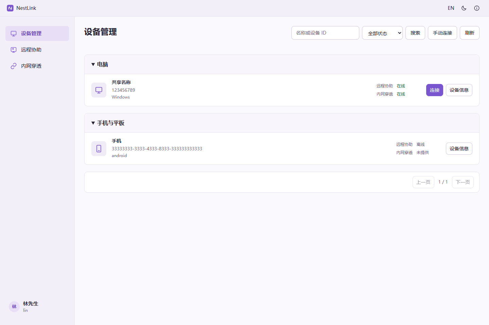
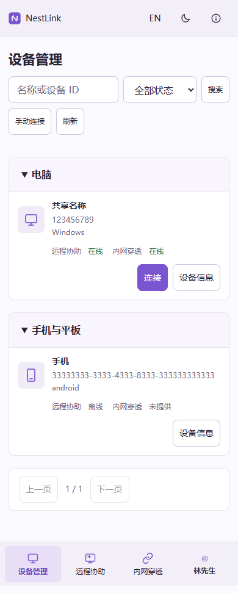

# 管理后台界面验证

界面以开发环境和测试数据验证。浏览器测试不能代替真实隧道、移动设备或长时间运行检查。

## 主要场景

| 场景 | 验证内容 |
| --- | --- |
| 公共首页与登录 | 下载入口、控制台返回链接、失效会话 |
| 主题与语言 | 一次点击只切换一次，用户资源名称保持原样 |
| 连接表单 | 字段错误、非敏感草稿保留、重复提交防护 |
| 多资源编辑 | 同名资源的草稿隔离，保存冲突后的恢复 |
| 后台刷新 | 不覆盖正在编辑的输入与焦点 |
| 权限 | 普通账号的设备、连接与配额归属 |
| 响应式布局 | 不同视口下的卡片、导航与键盘焦点 |
| 组件状态 | 区分未知、失败与健康状态，提供实际错误反馈 |

## 执行

在 `control-center/` 安装依赖与 Playwright Chromium 后执行 `pnpm run test:browser`。
配套服务测试覆盖接口行为与数据约束。桌面页面和 Android 交互分别在对应代码仓库维护。

## 当前界面与截图

当前文档使用 NestLink 14.0.1 的实际网页代码组件预览。新截图清单见 [14.0.1 manifest](assets/14.0.1/manifest.json)，记录当前网页源码文件 SHA-256、PNG 原始字节 SHA-256、视口、主题、页面、采集时间、Node/Chromium 工具摘要和本次独占预览进程身份。预览只监听 `127.0.0.1:44176`，使用 `ui-preview.mjs` 的模拟账号、设备及服务数据，浏览器外部请求被阻断；结束后已确认仅本次持有的子进程正常退出。

本轮新捕获包含八张中文 PNG：390px 手机与 1440px 桌面明暗设备目录、桌面穿透与远控页面、手机登录页，以及显示 14.0.1 的桌面版本弹窗。目录样例明确关联 GUI/background 主体并包含 Android 设备；这些是 `component-preview`，`installed_application=false`、`remote_session_verified=false`，不代表真实安装、媒体、输入、更新发现或穿透验收。首轮工具过早检查正在加载的版本弹窗而失败，失败原件保留；第二轮使用独立输出等待实际版本响应后完成。原 [14.0.0 manifest 与截图](assets/14.0.0/manifest.json) 按原始摘要保留为历史，未改写来源或复用为本版。

设备目录展示电脑、手机与平板以及各能力状态；远程协助和内网穿透各自独立管理，账号页集中管理员工具。现有浏览器回归用例在 320、390、768、1440px 检查目录与较大控件文字，在 390、1280、1440、1920、2560px 检查全部页面及弹窗布局，覆盖浅色与深色。用例范围不等于本轮八张预览图的实测范围；较大控件文字检查也不代表整页 200% 字体缩放验收。

现有主题切换回归在首帧检查可用次要按钮的文字对比度至少为 4.5:1；手机滚动用例检查最后一张设备卡片和分页操作完整位于固定底栏上方。

现有键盘导航回归控制设置接口的返回时机，检查迟到的页面响应不会抢走用户已移到导航按钮的焦点。

浏览器内远控需要实际登录的 Windows 或 Linux 设备批准或验证密码。截图本身不作为媒体、输入或穿透验收证据。
